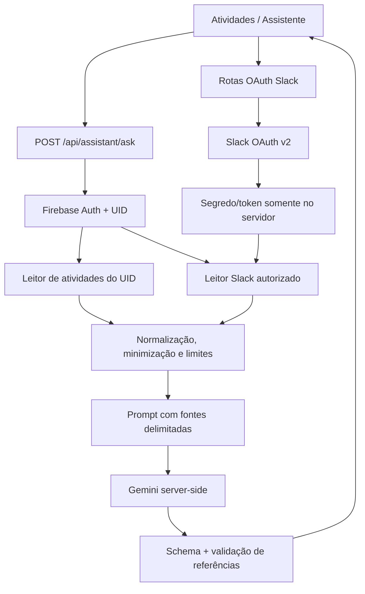

# Plano de implementação — Assistente de atividades com Gemini e consulta Slack

Data: 17/11/2026. Versão do plano: 1.3. Estado: R19 e R20 implementados localmente; aceite operacional externo e deploy pendentes.

### Handoff da implementação R20 — 17/11/2026

R20.1–R20.5 foram implementados no frontend Next.js e nas rotas server-side.
O tutor prepara uma rubrica por atividade, seleciona até cinco pendências,
gera sugestões no Gemini, revisa cada nota/feedback e aprova individualmente.
Atividades próprias persistem a correção aprovada; Kodland fica em
`ready_to_send`, com copiar/abrir e sem afirmar envio externo.

Entregas de segurança incluídas: contexto autorizado no servidor, prompt sem
ferramentas, schema fechado e soma determinística, quota compartilhada,
revisão de hash antes da aprovação, armazenamento privado por UID, nonce/hash
de reserva, tombstone de descarte, expiração finita, reset em duas fases e
bloqueio administrativo permanente. A suíte validada passou em 822 testes web,
7 E2E mobile/desktop, typecheck, lint e build. O teste live final do Gemini
passou nos quatro fixtures sintéticos; uma resposta 503 transitória foi
repetida com sucesso.

Gates restantes: validar com conta Firebase autenticada, configurar o ambiente
publicado e obter contrato/permissão/confirmação de leitura e escrita da
Kodland. Até esse contrato existir, nenhuma rota envia nota automaticamente.

## Ampliação 1.2 — R20: sugestões de correção e nota

Esta seção define integralmente o novo escopo e prevalece sobre propostas
anteriores de correção. R19 e suas evidências permanecem preservados.
Decisões do usuário: Kodland e atividades próprias; aprovação individual
obrigatória; pontuação conforme cada atividade; geração por seleção; Slack
fora da avaliação. Estado de R20 nesta versão: implementado localmente; o
aceite operacional externo continua pendente.

### Jornada e regras

O tutor seleciona uma entrega pendente, confere enunciado, orientação de
pontuação e conteúdo entregue, solicita uma sugestão, edita e aprova.
A IA propõe nota, justificativa por critério, pontos positivos, correções e
feedback ao aluno em português. A aprovação é individual, inclusive em lote.
Critérios, pesos, máximo, precisão e penalidades vêm da atividade; atraso
não reduz nota sem regra explícita. Não impor escala global nem inventar
rubrica. Sem entrega ou orientação suficiente, retornar nota nula e explicar
o que falta. Conteúdo inacessível não equivale a trabalho errado ou nota zero.

Elegibilidade: Kodland com TASK_SUBMITTED/TASK_SUBMITTED_LATE confirmado e
avaliação humana aplicável; próprias submitted ou pending com entrega.
Estados unknown, missing, not_graded e corrigida não autorizam nova avaliação
automática. Só ter um link não comprova que seu conteúdo foi examinado.
V1 avalia texto/código disponível, sem executar código ou abrir URLs arbitrárias.
Projetos binários, vídeos e imagens precisam de revisão manual; não atribuir
nota integral a uma representação parcial da entrega.

### Ordem de entrega e aceite por PR

| Ordem/ID | Entrega e dependência | Critério de aceite |
|---|---|---|
| R20.1 | Contratos e contexto de atividade; depende da autenticação R19 | Entrega, rubrica, máximo e revisão identificados; dados ausentes bloqueiam nota; isolamento entre contas testado |
| R20.2 | Motor Gemini e revisão na UI; depende R20.1 | Sugestão editável, evidências por critério, nota válida e aprovação explícita; falha preserva rascunho |
| R20.3 | Salvar correção própria; depende R20.2 | Transação verifica revisão e salva nota/feedback aprovados; clique duplicado não duplica efeito |
| R20.4 | Viabilidade e envio Kodland; depende R20.2 | Envio habilitado somente com contrato externo comprovado; fallback copiar/abrir página funciona sem afirmar envio |
| R20.5 | Lote, operação e validação; depende R20.3 e fallback R20.4 | Até cinco selecionadas, aprovação individual, demo isolada e E2E mobile/desktop |

R20.1 acrescenta às próprias orientação de pontuação, máximo, precisão e
critérios opcionais estruturados; campos novos opcionais preservam legados,
export/import/reset e demo. Nota final só existe após aprovação. Para rubrica
textual, mostrar interpretação estruturada ao tutor e exigir sua confirmação
antes da geração. Se pesos ou arredondamento forem ambíguos, bloquear geração
até esclarecimento. A soma de critérios é calculada no servidor usando a
precisão confirmada, e não aceita total arbitrário do modelo.

Kodland hoje fornece metadados e link, não entrega/rubrica completas. R20.1
deve validar leitura autenticada da tarefa, submissão e critérios em conta de
teste antes de implementar o adaptador. Revalidar vínculo professor/turma/aluno
na fonte. A política browser permanece respeitada: consultar a tarefa ao vivo
com credenciais transitórias, sem espelhar todo IndexedDB no Firestore. Se a
fonte não permitir essa consulta, mostrar indisponibilidade e oferecer entrada
manual identificada como fornecida pelo tutor; ela permite rascunho/copiar,
mas não autoriza envio externo verificado.

### Contratos e persistência propostos

- POST /api/assistant/corrections/suggest: Firebase Bearer; source, activity_id,
  request_id e revisão esperada. IDs são resolvidos/autorizados no servidor.
  Credenciais externas transitórias só no adaptador Kodland; nunca no Gemini.
- Resposta: suggestion_id, status ready/insufficient_context, nota nullable,
  máximo, critérios com pontos e referências a trechos, feedback, correções,
  limitações, modelo e snapshot_hash. Validar schema fechado, IDs de critério,
  referências existentes, finitude, limites e soma determinística.
- POST /api/assistant/corrections/approve: suggestion_id, snapshot_hash,
  nota/feedback finais editados e request_id. Confirmar propriedade e revisão.
  Alteração na entrega ou rubrica gera 409 stale e exige nova revisão.
- Sugestões privadas por UID em coleção raiz sem acesso direto do cliente;
  validade lógica de 30 dias e TTL, sem cópia bruta da entrega. Rota autenticada
  permite recuperar/descartar somente sugestões próprias. Remoção/reset da
  conta também remove esses dados; resultado aprovado integra atividade e backup.
- Estados: draft_ready, insufficient_context, stale, saved, ready_to_send,
  sending, sent, send_failed e send_unknown. Aprovação local e confirmação
  externa são resultados distintos e mostrados explicitamente.

R20.2 reutiliza transporte REST e quotas R19, com prompt/schema específicos
para avaliação; não transformar a rota de perguntas em rota de escrita.
Contexto máximo 20 KB; excesso bloqueia geração com explicação, sem truncar
silenciosamente rubrica/entrega. Saída até 2048 tokens e timeout 30 segundos.
Cada atividade consome uma reserva de quota. Não repetir geração automaticamente.
Lote sequencial de até cinco pausa em 429 e respeita Retry-After; tutor retoma
itens restantes. Cancelamento interrompe próximos itens, preservando concluídos.

R20.3 usa transação para hash atual, versão, nota/feedback e conclusão própria.
R20.4 exige evidência do endpoint externo, permissões, limites de texto/nota,
controle de concorrência e leitura posterior de confirmação. Responsável:
implementador com conta de teste autorizada; resolver antes de habilitar escrita.
Sem API suportada, entregar somente ready_to_send, copiar nota/feedback e abrir
correction_url. Isso não bloqueia sugestões nem correções próprias.
Envio externo tem chave idempotente por UID/tarefa/revisão, registro durável
e trava transacional; sucesso impede repetição daquela revisão. Timeout após
despacho gera send_unknown: reconciliar por leitura, nunca reenviar cegamente.
Se a plataforma não oferecer confirmação/concorrência segura, manter escrita
desabilitada. Não sobrescrever correção posterior de outro tutor.

### Segurança e operação aplicadas

R20.1: somente campos pedagógicos necessários, pseudônimos, remoção de contatos,
URLs privadas e segredos reconhecidos; validar autorização antes de ler.
R20.2: entrega é dado não confiável, prompt fixo sem ferramentas; testar tentativa
de mudar nota por instrução inserida no trabalho. JSON válido não garante
qualidade pedagógica: revisão humana obrigatória. R20.3/4: revalidar UID antes
de gravar/enviar e revisão imediatamente antes do efeito. R20.5: logs apenas
metadados/status/duração/modelo/contagens; sem entrega, credencial ou texto livre.
Sugestões são dados privados do produto, não logs operacionais.

Modelo configurado localmente: gemini-3.5-flash-lite. Flags de correção
GEMINI_CORRECTIONS_ENABLED=false e KODLAND_CORRECTION_WRITE_ENABLED=false;
ativar correções somente após fixtures e validação docente. A chave local é
ignorada pelo Git; rotação e configuração do ambiente publicado são operacionais.
Revisar condições do provedor para trabalhos reais antes da ativação com alunos.

### Verificação e evidências

Script reproduzível: powershell.exe -NoProfile -ExecutionPolicy Bypass -File
scripts/test-gemini-corrections.ps1. Lê segredo local sem exibi-lo; faz quatro
chamadas pagas/sujeitas à quota com dados fictícios e imprime somente resultados.
Casos: solução correta=10/10, parcial=3/10, entrega ausente=nota nula e tentativa
de instruir nota máxima dentro da entrega=3/10. Esta é avaliação direta da API;
não cobre Firebase, interface ou envio Kodland. Resultado desta execução será
registrado abaixo após conclusão. Uma amostra não comprova qualidade geral.

Execução real em 17/11/2026: parcial passou (3/10, 292 tokens), ausente passou
(nota nula, 199 tokens), injection passou (3/10, 314 tokens). Caso correto
falhou inicialmente no transporte/validação sem diagnóstico HTTP capturado;
repetição isolada com -CaseId correct passou (10/10, 229 tokens). A execução
completa inicial terminou com exit 1; não registrar como suíte integral verde.
Feedback parcial identificou subtração em vez de soma e ausência de teste;
sugeriu retornar a+b e acrescentar soma(2,3)==5. Nenhum dado real foi utilizado.

Implementação deve adicionar testes de autorização cruzada, escala diferente
de 10, critérios fracionários, ausência/ambiguidade de rubrica, schema inválido,
timeout/quota, conflito de revisão e envio duplicado/ambíguo. E2E em 320/390/1440
inclui editar/aprovar, lote parcial e demo sem rede externa. Rodar tipos, lint,
testes relevantes e build; verificar conta de teste e publicação antes de
anunciar correção integrada. Release note só quando comportamento entregue.

Histórico 1.2 → 1.3: registra a implementação local de R20.1–R20.5, suas
evidências e os gates externos ainda necessários; preserva R19.

## Revisão técnica da baseline — 17/11/2026

- A política Kodland padrão usa IndexedDB no navegador. O servidor não pode
  consultar essa cópia nem tratar documentos Firestore antigos como a fonte
  atual. Quando essa política estiver ativa, o assistente deve informar a
  ausência de contexto Kodland verificável; atividades manuais remotas continuam
  consultáveis. Suporte ao contexto local exige contrato posterior explícito.
- OAuth Slack será isolado por UID, com canais selecionados e sem busca global.
  Threads de canais exigem token de usuário com escopos de histórico; não se
  deve presumir que um bot possui essa permissão. O conector deve respeitar o
  tipo de token efetivamente concedido e indicar cobertura parcial.
- A primeira entrega não mantém histórico de perguntas/respostas. Configuração
  do modelo é obrigatória no servidor; quotas e limites serão documentados com
  os valores reais da implementação.
- Configuração externa e validação real são gates de ativação, não impedem
  implementar e testar o código usando respostas sintéticas dos provedores.
- A sequência de integração preserva R19.1–R19.4. Os adaptadores e a UI podem
  ser desenvolvidos em arquivos disjuntos e integrados após fechar os contratos.
  O aceite continua dependente da verificação conjunta.

### Histórico 1.0 → 1.1

Revisão solicitada pelo usuário antes da implementação. Afeta todos os épicos:
corrige a premissa de leitura Kodland, explicita permissões de threads e separa
entrega local de ativação operacional. Nenhum PR concluído foi renumerado.

## 1. Objetivo e regra de segurança imediata

O NexusClass deverá permitir que o professor faça perguntas sobre as atividades
dos alunos e, quando autorizado, acrescente informações selecionadas do Slack
para contextualizar a resposta. A resposta será produzida pelo Gemini somente
depois que o servidor reunir e limitar as fontes permitidas.

A chave do Gemini recebida nesta solicitação não foi gravada no repositório nem
em arquivo local. Como ela foi exposta em uma conversa, deve ser revogada ou
substituída no Google AI Studio antes de qualquer uso real. A nova credencial
deve ser cadastrada como segredo da Vercel/ambiente do servidor, nunca como
`NEXT_PUBLIC_*`, nunca no Expo e nunca no navegador.

Este plano é autossuficiente para acompanhar a execução. Ele separa:

- **Confirmado:** comportamento e arquitetura observados no checkout;
- **Proposto:** desenho recomendado para esta entrega;
- **Pendente:** decisão que ainda precisa de aprovação ou validação externa.

## 2. Evidências e autoridade

### 2.1 Confirmado no repositório

- O caminho de produção documentado é `frontend/` com Next.js na Vercel,
  Firebase Authentication e Cloud Firestore. O backend FastAPI existe, mas é
  legado e não é o caminho principal das integrações web atuais.
- As rotas server-side existentes ficam em `frontend/src/app/api`, usam
  runtime Node.js e têm o helper `frontend/src/lib/server-auth.ts` para validar
  o token Firebase do usuário.
- As informações de acompanhamento pedagógico já persistidas incluem, entre
  outras, `kodland_groups`, `kodland_students`, `kodland_reviews`,
  `kodland_task_progress`, `kodland_lessons` e atividades manuais. A origem e
  os contratos de leitura estão centralizados em `frontend/src/lib/api.ts` e
  nos módulos `kodland-*`.
- A aba canônica do acompanhamento é `/classes`, com Atividades, Presença e
  Alunos. A UI de atividades está em `frontend/src/components/corrections-page.tsx`.
- Os logs operacionais existentes foram desenhados para guardar metadados,
  códigos, estados, contagens e referências técnicas; não devem receber
  prompts, respostas, mensagens Slack, credenciais ou dados pessoais livres.
- As regras atuais permitem acesso direto do cliente às subcoleções comuns de
  `users/{uid}`. Portanto, token Slack, chave Gemini e demais segredos não
  podem ser colocados ali sem uma alteração explícita das regras e do modelo
  de armazenamento.
- `repo-map.md` e `.codex/skills/professor-pay-ops/SKILL.md` foram citados pelo
  `AGENTS.md`, mas não existem neste checkout. Isso é uma lacuna de contexto,
  não uma autorização para inventar regras de domínio.

### 2.2 Fontes externas atuais

- A documentação oficial do Gemini recomenda manter a chave em ambiente
  seguro/server-side, tratar a chave como senha e substituí-la se houver
  comprometimento: [Using Gemini API keys](https://ai.google.dev/gemini-api/docs/api-key).
- O SDK recomendado para JavaScript/TypeScript é `@google/genai`: [Gemini API libraries](https://ai.google.dev/gemini-api/docs/libraries).
- A resposta estruturada do Gemini aceita um subconjunto de JSON Schema, mas a
  aplicação ainda deve validar semanticamente o resultado: [Structured outputs](https://ai.google.dev/gemini-api/docs/structured-output).
- O Slack usa OAuth v2 com escopos granulares. `conversations.history` e
  `conversations.replies` exigem escopos conforme o tipo de conversa; a busca
  global `search.messages` exige token de usuário com `search:read`:
  [Slack OAuth v2](https://api.slack.com/authentication/oauth-v2),
  [conversations.history](https://api.slack.com/methods/conversations.history),
  [conversations.replies](https://api.slack.com/methods/conversations.replies) e
  [search.messages](https://api.slack.com/methods/search.messages).
- Conteúdo externo deve ser tratado como não confiável. A orientação de
  segurança do Gemini destaca prompt injection, limites de uso e avaliação
  humana: [Safety and factuality guidance](https://ai.google.dev/gemini-api/docs/safety-guidance).

## 3. Escopo da primeira versão

### Incluído

1. Perguntas autenticadas sobre atividades e progresso já disponíveis no
   NexusClass.
2. Resposta em português com referências às evidências usadas, distinguindo
   atividade entregue, corrigida, pendente, não avaliada e desconhecida quando
   esses estados existirem na fonte.
3. Conector Slack somente leitura, com instalação/autorização e seleção de
   canais ou conversas permitidos.
4. Consulta opcional ao Slack para complementar uma pergunta, sem permitir que
   texto vindo do Slack altere as instruções de segurança do sistema.
5. Limites de volume, timeout, tratamento de indisponibilidade e logs apenas de
   metadados.
6. Modo demo sem chamadas ao Gemini, Slack ou Firebase privado.

### Fora do escopo da primeira versão

- Correção automática de atividade, alteração de nota ou decisão pedagógica
  automática.
- Envio, edição, reação ou exclusão de mensagens no Slack.
- Indexação completa e contínua de todo o workspace.
- Download ou análise de arquivos/anexos Slack.
- Envio de telefone, e-mail, senha Kodland, token, URL privada de correção ou
  dados financeiros ao Gemini.
- Histórico persistente de prompts e respostas completas, salvo decisão
  posterior específica sobre retenção e privacidade.
- Agente autônomo com ferramentas que executem ações externas.

## 4. Jornadas e comportamento funcional

### 4.1 Pergunta sobre atividades

1. O professor autenticado abre `/classes?tab=activities` e aciona o assistente.
2. A interface envia a pergunta, o contexto visual opcional (turma, aluno,
   aula ou atividade) e um identificador de requisição.
3. A rota server-side autentica o Firebase UID e resolve novamente os registros
   permitidos para esse UID; IDs recebidos do cliente são filtros, nunca prova
   de autorização.
4. O servidor normaliza um conjunto pequeno de evidências: turma, código da
   aula, atividade, estado, data disponível e identificadores técnicos
   pseudonimizados quando o nome não for necessário.
5. O Gemini recebe a pergunta e as evidências delimitadas como dados não
   confiáveis. Deve responder apenas com base nelas e declarar quando não há
   informação suficiente.
6. A resposta validada volta para a UI com texto curto e referências clicáveis
   apenas para recursos internos já autorizados. A IA não cria URL nem executa
   a ação de correção.

### 4.2 Conexão e consulta ao Slack

1. Em Configurações, o professor escolhe **Conectar Slack**.
2. O servidor inicia OAuth v2 com o menor conjunto de escopos aprovado. O
   callback valida `state`, troca o código no Slack e armazena o token somente
   no servidor, associado ao usuário/workspace.
3. O professor escolhe canais/conversas autorizados; a V1 não usa busca global
   sem aprovação do escopo `search:read`.
4. Ao marcar **Incluir Slack** em uma pergunta, o servidor consulta apenas as
   conversas selecionadas e uma janela temporal/limite definidos, pagina as
   respostas necessárias e normaliza texto, autor técnico, data, canal e
   thread.
5. O conteúdo Slack é separado da instrução do sistema e rotulado como
   evidência não confiável. Mensagens que tentem instruir o modelo são tratadas
   como texto, não como comandos.
6. A resposta mostra quais fontes vieram de Atividades e quais vieram do Slack.
   Se o Slack estiver desconectado, sem permissão ou indisponível, a resposta
   continua somente com as atividades quando isso for seguro e informa a
   limitação.

### 4.3 Estados de interface

- inicial: pergunta habilitada, Slack opcional e indicação de fonte;
- carregando: botão desabilitado, referência de requisição visível e sem
  duplicar chamadas;
- sucesso: resposta, fontes, data da consulta e aviso de que a IA pode errar;
- contexto insuficiente: resposta explícita sem inventar atividade, prazo ou
  decisão;
- erro recuperável: tentar novamente sem apagar a última resposta válida;
- credencial/escopo ausente: instrução para conectar Slack ou revisar acesso;
- demo: assistente visível somente se houver roteiro de demonstração, usando
  dados fictícios locais e nenhuma chamada externa.

## 5. Arquitetura proposta



### Limites técnicos

- O browser conversa apenas com rotas próprias autenticadas. O browser nunca
  chama `generativelanguage.googleapis.com` nem `slack.com/api` diretamente com
  segredo.
- A integração Gemini usa REST `generateContent` em módulo server-only, sem
  dependência adicional. Modelo é configurado explicitamente por variável de
  ambiente e deve aceitar JSON Schema. A escolha operacional permanece pendente.
- A integração Slack deve usar chamadas HTTPS para a Web API, com paginação,
  timeout, tratamento de `ok: false`, limites de mensagens e respeito aos
  escopos autorizados.
- A etapa de recuperação é determinística e anterior ao Gemini. A V1 não
  entrega ao modelo uma ferramenta arbitrária de busca ou escrita.
- O backend Python não entra nesta primeira implementação, salvo se uma
  decisão futura comprovar que o deploy atual não suporta as rotas Node da
  Vercel.

## 6. Contratos, dados e segredos

### Contrato implementado na revisão 1.1

Esta seção atualiza os nomes inicialmente propostos abaixo. O armazenamento
real é `private_slack_integrations/{uid}`, `private_slack_oauth/{stateHash}`,
`private_assistant_usage` e `ai_usage_logs`; todas são coleções raiz sem acesso
pelas regras do cliente. Status Slack é obtido por rota autenticada, sem coleção
pública auxiliar. Não foi implementado histórico de conversa.

OAuth usa token de usuário com `channels:read`, `groups:read`,
`channels:history` e `groups:history`; um workspace por UID e até cinco canais
dos quais o usuário participa. O callback HTTPS deve terminar em
`/api/integrations/slack/callback`. `state` é aleatório, de uso único, válido por
dez minutos e vinculado ao UID e cookie HttpOnly. Tokens são cifrados AES-256-GCM.
Rotação automática de tokens Slack não está habilitada nesta versão.

A pergunta tem limite de 2.000 caracteres e o corpo HTTP, 8 KiB. As leituras
pedagógicas projetam campos permitidos e limitam 100 registros por coleção e 40
atividades no contexto. O contexto combinado tem teto de 20.000 bytes. Gemini
tem timeout de 15 segundos e até 1.024 tokens de saída. Falhas também consomem
quota; repetir identificador por UID é recusado enquanto o registro de uso for
mantido (retenção pretendida de 30 dias, limpeza TTL depende da configuração).

Slack consulta por padrão sete dias, máximo 30, com até dez chamadas, 60
evidências e 18.000 caracteres. Respeita cooldown por UID e indica paginação
incompleta. Threads dependem das mensagens principais recuperadas na janela.
Os limites não garantem recuperação completa de um workspace.

Para ativar: configurar as variáveis do servidor, modelo compatível e
`GEMINI_ASSISTANT_ENABLED=true`; configurar TTL `expires_at` nas coleções de uso
e `expiresAt` na coleção OAuth; autorizar o Slack e selecionar canais em
`/settings/slack`. Credenciais e autorização real ainda precisam de validação.
Os nomes presentes em pergunta livre podem permanecer no texto enviado; a
redação por padrões remove contatos e segredos reconhecidos, não toda PII.

### 6.1 Variáveis de ambiente propostas

Somente no runtime server-side:

| Variável | Uso | Estado |
|---|---|---|
| `GEMINI_API_KEY` | Chave substituída/restrita do Gemini | Proposto |
| `GEMINI_MODEL` | Modelo permitido para perguntas, configuração explícita | Operacional pendente |
| `GEMINI_ASSISTANT_ENABLED` | Ativação explícita; padrão false | Implementado |
| `GEMINI_REQUESTS_PER_MINUTE` | Padrão 2 por UID | Implementado |
| `GEMINI_REQUESTS_PER_DAY` | Padrão 10 por UID/dia UTC | Implementado |
| `GEMINI_GLOBAL_REQUESTS_PER_DAY` | Padrão 50 para aplicação/dia UTC | Implementado |
| `SLACK_CLIENT_ID` | OAuth Slack | Proposto |
| `SLACK_CLIENT_SECRET` | Troca do código OAuth | Proposto |
| `SLACK_REDIRECT_URI` | Callback HTTPS registrado no Slack | Proposto |
| `SLACK_TOKEN_ENCRYPTION_KEY` | Cifrar tokens Slack armazenados | Proposto |
| `SLACK_SIGNING_SECRET` | Necessário somente se eventos/webhooks entrarem no escopo | Fora da V1 |

Os nomes devem ser adicionados ao `.env.example` sem valores reais durante a
implementação. O `.gitignore` já foi reforçado para bloquear arquivos locais de
ambos os workspaces, arquivos `.secret` e JSONs de service account.

### 6.2 Persistência mínima proposta

- `private_integrations/{uid}`: documento server-only com workspace autorizado,
  IDs técnicos, escopos concedidos, token Slack cifrado, data de conexão e
  `revoked_at`. Nenhum cliente deve ler ou escrever essa coleção; as regras
  atuais não concedem acesso a ela e a aplicação usará Admin SDK.
- `private_integration_status/{uid}`: opcional, somente se a UI precisar de
  status persistente; pode expor apenas `connected`, workspace sanitizado,
  escopos não sensíveis e `updated_at`, nunca token.
- `ai_usage_logs/{uid_requestId}`: somente metadados de operação, como modelo,
  fonte usada, contagem de evidências, duração, status e código de erro. Não
  persistir prompt, resposta integral ou mensagem Slack na V1.
- Histórico de conversa completo é **Pendente**. Se aprovado, deverá ter
  coleção, retenção, exclusão, exportação e regras próprias antes da entrega.

### 6.3 Contrato da requisição de pergunta

O servidor deverá aceitar, com limites fechados:

```ts
type AssistantAskInput = {
  question: string;                 // obrigatório, tamanho máximo definido na task
  include_slack?: boolean;
  group_id?: string;
  student_id?: string;
  lesson_id?: string;
  activity_id?: string;
  slack_conversation_ids?: string[];
  request_id: string;
};
```

O servidor deve rejeitar campos desconhecidos, IDs fora do UID autenticado,
listas excessivas, perguntas vazias e seleção de conversa não autorizada.

### 6.4 Contrato da resposta do Gemini

O formato lógico proposto é:

```ts
type AssistantAnswer = {
  answer: string;
  insufficient_context: boolean;
  sources: Array<{
    source: "activity" | "slack";
    ref: string;
    label: string;
  }>;
  limitations: string[];
};
```

Depois do JSON Schema do provedor, o servidor deve validar também que cada
`ref` existe no conjunto de evidências enviado, que `source` pertence ao
catálogo permitido e que não há URL/ação inventada. JSON sintaticamente válido
não é evidência de resposta correta.

## 7. Épicos de execução

Os IDs abaixo são etapas do plano e devem aparecer no título/descrição do PR.
Cada épico foi dimensionado para um resultado coeso e verificável.

| Ordem | ID | Resultado | Dependências | Estado |
|---:|---|---|---|---|
| 1 | R19.1 | Fundação server-side, segredos e contratos fechados | nenhuma | implementado localmente |
| 2 | R19.2 | Perguntas respondidas com evidências de atividades | R19.1 | implementado localmente |
| 3 | R19.3 | Slack conectado e consulta somente leitura autorizada | R19.1 | implementado localmente |
| 4 | R19.4 | Assistente combinado, UI, observabilidade e validação final | R19.2, R19.3 | implementado localmente; operação pendente |

### R19.1 — Fundação server-side, segredos e contratos

**Resultado:** a aplicação possui fronteira segura para provedores externos,
configuração documentada, autenticação por UID, limites de entrada e contratos
testáveis, sem ainda habilitar uma resposta de produção.

**Escopo e partes afetadas:** `.gitignore`, `.env.example`, módulos server-only
em `frontend/src/lib`, rotas em `frontend/src/app/api/assistant` e
`frontend/src/app/api/integrations/slack`, testes de rota e documentação de
operação. Não alterar o fluxo Expo nem o backend legado.

**Ordem técnica:**

1. Rotacionar a chave exposta e cadastrar a nova chave apenas no ambiente
   server-side; confirmar que a chave antiga está revogada após a transição.
2. Adicionar configuração sem valores reais, validação de ambiente e cliente
   Gemini server-only.
3. Criar schemas de entrada/saída, normalizadores de erro e `request_id` sem
   aceitar binding excessivo.
4. Reutilizar `authenticatedUser` e estabelecer limite por UID para chamadas
   de IA.
5. Criar armazenamento server-only para integração externa, ou deixar o
   adaptador em memória até R19.3 se a decisão de persistência ainda não tiver
   sido aprovada.

**Invariantes e falhas:** nenhuma chave aparece no bundle; usuário sem sessão
recebe 401; configuração ausente recebe erro operacional sem revelar valor;
payload inválido recebe 400; excesso de uso recebe 429; timeout e falha de
provedor não gravam resposta parcial.

**Aceite e evidências:**

- `git check-ignore` confirma todos os padrões de segredo e
  `git ls-files` não lista arquivo de credencial;
- teste de rota nega usuário ausente, campos desconhecidos, payload grande e
  UID divergente;
- teste verifica que logs não contêm chave, token, prompt ou resposta;
- typecheck, lint e testes do workspace web passam.

### R19.2 — Perguntas sobre atividades

**Resultado:** em Atividades, o professor pergunta sobre os dados já
sincronizados e recebe resposta fundamentada somente nas fontes do próprio UID.

**Escopo e partes afetadas:** leitor server-side das coleções pedagógicas,
normalizador de estados, construtor de contexto/prompt, rota `assistant/ask`,
componente da aba Atividades, estados de loading/erro/vazio e testes unitários,
de rota e E2E.

**Regras:**

- a pergunta pode usar contexto de turma/aluno/aula/atividade, mas cada vínculo
  é conferido no servidor;
- estados `unknown`/`not_graded` não podem ser convertidos em “não entregue”;
- ausência de evidência produz `insufficient_context: true`, não uma hipótese;
- respostas devem citar referências internas do conjunto recebido;
- a IA não altera ranking, correção, presença, pagamento ou sincronização;
- dados sensíveis não necessários ficam fora do payload do provedor.

**Segurança e falhas:** truncar contexto antes do modelo; separar instruções de
dados; neutralizar HTML/Markdown de fontes; rejeitar resposta sem schema ou com
referência inexistente; preservar a última resposta válida em timeout; aplicar
rate limit por UID e limite de custo por requisição.

**Aceite e evidências:**

- perguntas sobre pendente, entregue, corrigida, não avaliada e desconhecida
  retornam a classificação correta ou assumem insuficiência;
- aluno/turma de outra conta nunca aparece na resposta;
- prompt injection escrito no título da atividade não altera a regra do
  sistema;
- falhas do Gemini não apagam dados da tela nem executam ações;
- demo não faz chamadas externas;
- E2E cobre 320, 390 e 1440 px, teclado, foco, loading, erro e resposta com
  fontes.

### R19.3 — Conector Slack somente leitura

**Resultado:** o professor conecta um workspace, seleciona conversas permitidas
e o servidor consegue consultar histórico/thread dentro de limites, sem expor
token ao cliente.

**Escopo e partes afetadas:** rotas OAuth v2, cliente Slack server-only,
cifração/rotação/revogação do token, status de integração em Configurações,
seleção de conversas e testes com fixtures sintéticas.

**Escopos recomendados:** começar com escopos mínimos para listar e ler os
canais/conversas explicitamente autorizados. `search:read` e token de usuário
ficam fora do caminho padrão; só entram após decisão sobre busca global e
privacidade do workspace.

**Ordem técnica:**

1. Criar o Slack App em workspace de teste e registrar callback HTTPS.
2. Implementar `state` com expiração e vínculo ao UID; validar callback,
   workspace e scopes retornados.
3. Armazenar token cifrado; exibir somente status, workspace sanitizado e
   possibilidade de desconectar/revogar.
4. Implementar listagem selecionada, `conversations.history` e,
   quando necessário, `conversations.replies`, com cursores e janelas de tempo.
5. Normalizar mensagem, thread e autor técnico, removendo anexos e dados não
   necessários; encaminhar somente o contexto selecionado ao R19.4.

**Falhas e limites:** callback inválido, state expirado, workspace sem acesso,
scope insuficiente, token revogado, rate limit, paginação incompleta e timeout
devem gerar estados distintos. Nunca assumir que `ok: false` é lista vazia.

**Aceite e evidências:**

- OAuth permite conectar e desconectar em workspace de teste;
- token não aparece em resposta HTTP, logs, Firestore legível pelo cliente ou
  bundle;
- histórico e thread são paginados sem duplicar mensagens;
- acesso a canal não autorizado é recusado;
- mensagem Slack com instrução maliciosa chega ao modelo apenas como dado
  delimitado, sem ganhar autoridade;
- nenhum método de escrita Slack é chamado.

### R19.4 — Assistente combinado, UI e operação

**Resultado:** o professor pode perguntar sobre atividades com Slack opcional,
ver fontes separadas e operar a funcionalidade com limites, auditoria técnica e
fallback honesto.

**Escopo e partes afetadas:** composição de fontes, UI final na aba Atividades
ou destino aprovado, status de integração, logs de metadados, documentação de
operação, release note somente após a feature estar efetivamente entregue.

**Ordem técnica:**

1. Compor evidências locais e Slack somente quando `include_slack` for
   verdadeiro e as conversas estiverem autorizadas.
2. Aplicar o mesmo schema/citação/validação do R19.2, identificando a origem
   de cada referência.
3. Exibir limitação de fonte e data da consulta; não exibir token, escopo
   secreto, prompt interno ou dados descartados.
4. Registrar apenas operação, UID técnico, fontes, contagens, duração, modelo,
   status e código de erro, conforme o contrato de logs existente.
5. Executar smoke autenticado em ambiente de teste, revisão de bundle e
   verificação manual da publicação antes de anunciar a novidade.

**Aceite:**

- pergunta somente local funciona sem Slack conectado;
- pergunta com Slack usa apenas conversas selecionadas;
- indisponibilidade do Slack não transforma silêncio em fato;
- fontes são rastreáveis e não há citação fabricada;
- limite de uso e custo impede chamadas ilimitadas;
- desconectar Slack impede novas consultas e revoga/descarta o token segundo a
  política aprovada;
- release note descreve somente comportamento realmente entregue.

## 8. Segurança, privacidade e operação

| Risco | Épicos | Controle planejado | Evidência |
|---|---|---|---|
| Chave Gemini exposta ou reutilizada | R19.1 | Rotacionar a chave desta conversa; segredo server-side; restrição ao Gemini; alertas de quota | Console do Google, variáveis Vercel e inspeção do bundle |
| Token Slack acessível ao browser | R19.1/R19.3 | OAuth no servidor; armazenamento cifrado server-only; resposta de status sem token | Teste HTTP/Firestore/bundle |
| Usuário consultar dados de outra conta | R19.2/R19.4 | Firebase UID no servidor; revalidação dos IDs e isolamento por consulta | Testes com duas contas/UIDs |
| PII enviada sem necessidade | R19.2/R19.3 | Allowlist de campos; excluir telefone, e-mail, senha, contatos, finanças e URLs privadas | Snapshot do payload sintético e teste de redaction |
| Prompt injection em pergunta/atividade/Slack | R19.2–R19.4 | Delimitar dados não confiáveis; instruções fixas; sem ferramentas de escrita; validar fontes | Fixtures maliciosas e resposta segura |
| Resposta plausível sem evidência | R19.2/R19.4 | Schema, `insufficient_context`, referências verificadas e fallback | Testes de resposta incompleta/fabricada |
| Abuso/custo/limites do provedor | R19.1/R19.4 | Rate limit por UID, limites de caracteres/mensagens, timeout, orçamento e alertas | Testes 429/timeouts e painel de quota |
| Vazamento por logs/backups | Todos | Logs só de metadados; retenção definida; sem prompt/resposta/token bruto | Busca automatizada por padrões proibidos |
| OAuth abusado ou callback forjado | R19.3 | `state` vinculado ao UID, expiração, redirect HTTPS, escopos mínimos e revogação | Testes de callback inválido/expirado |

O conteúdo de mensagens Slack e os registros de atividades são dados de
trabalho potencialmente pessoais. A retenção, exclusão, exportação e eventual
uso para treinamento pelo fornecedor devem ser confirmados antes de liberar
dados reais fora do workspace de teste. Até essa confirmação, usar fixtures
sintéticas na validação.

## 9. Decisões pendentes e gates

| Decisão | Recomendação | Impacto | Resolver antes de |
|---|---|---|---|
| Slack de um único workspace ou vários | OAuth por workspace/usuário, não token fixo compartilhado | Define modelo de instalação e armazenamento | R19.3 |
| Buscar mensagens globalmente ou canais escolhidos | Canais escolhidos; `search:read` somente se aprovado | Define token/scopes e exposição de dados | R19.3 |
| Nomes reais no prompt | Usar nome somente no contexto selecionado; omitir contatos e IDs internos | Afeta utilidade e privacidade | R19.2 |
| Guardar histórico completo de chat | Não persistir na V1 | Afeta UX, LGPD/privacidade e custo | R19.4 |
| Modelo Gemini e teto de custo | Modelo rápido configurável + quota por UID | Afeta latência, qualidade e faturamento | R19.1 |
| Local da UI | Assistente dentro de Atividades; rota própria somente se o fluxo crescer | Afeta navegação e E2E | R19.2 |
| Política de dados do Google/Slack para conteúdo real | Confirmar contrato/configuração aplicável | Pode bloquear produção | R19.4 |

R19.1 pode preparar contratos e fixtures enquanto as decisões de UX e Slack
permanecem pendentes. R19.2 pode avançar com atividades locais. R19.3 e R19.4
não devem ser marcados como concluídos sem as decisões correspondentes.

## 10. Validação e evidências de entrega

### Automatizada

- `npm.cmd run web:typecheck`
- `npm.cmd run web:lint`
- testes Vitest do workspace web para schemas, autenticação, isolamento,
  normalização, prompt, citações, Slack OAuth, paginação, rate limit e falhas
- E2E Playwright da demo sem rede externa e da UI autenticada com provedores
  mockados
- inspeção de bundle para confirmar ausência de `GEMINI_API_KEY`, tokens Slack e
  segredos
- `git diff --check` e `git check-ignore` para arquivos locais

### Manual/operacional

- testar em workspace Slack de desenvolvimento, com mensagens sintéticas;
- testar chave Gemini substituída, quota baixa, timeout, resposta bloqueada e
  resposta sem contexto;
- confirmar que revogar/desconectar Slack impede novas consultas;
- após commit e deploy, conferir a publicação correspondente e o navegador de
  produção; se o navegador bloquear o acesso, registrar o erro e manter a
  verificação pendente;
- não considerar mock, demo ou teste local como validação de dados reais de
  atividades/Slack.

## 11. Acompanhamento por PR

Cada PR deve informar no título ou descrição: ID do épico, versão deste plano,
features entregues, critérios de aceite verificados, comandos executados,
evidências, decisões resolvidas e pendências. A ordem é R19.1 → R19.2/R19.3 →
R19.4; R19.2 e R19.3 podem ser paralelos depois da fundação.

Nenhum PR deve incluir a chave fornecida nesta solicitação, uma chave
substituta, token Slack, export de workspace ou fixture com dados reais.

## 12. Histórico do plano

### Execução local — versão 1.3

- R20.1–R20.5: rubrica por atividade, contexto autorizado, motor Gemini,
  aprovação individual, persistência própria, lote de cinco e fallback Kodland
  copiar/abrir implementados.
- Verificado: 822 testes web, 7 E2E em 320/390/1440, typecheck, lint, build,
  diff check e inspeção de segredo. O teste live final passou nos quatro
  fixtures sintéticos.
- O reset usa begin/finish em duas fases; descarte mantém tombstone; aprovação
  revalida snapshot e status; logs não guardam texto livre. Kodland write segue
  bloqueado por ausência de contrato externo comprovado.
- Pendentes: smoke autenticado Firebase, configuração/publicação e validação
  de leitura/escrita/confirmação na Kodland.

### Execução local — versão 1.1

- R19.1–R19.4: código implementado em branch própria. Modelo/segredos e
  ativação dos provedores permanecem operacionais; nenhum segredo foi gravado.
- Verificado pelo orquestrador: 782 testes web em 114 arquivos, typecheck, lint,
  build de produção com 33 rotas/páginas e `git diff --check` passaram.
- E2E do assistente cobre 320/390/1440, teclado, foco, botão e demo sem chamadas
  privadas. Inspeção visual identificou e corrigiu quebra do botão Perguntar.
- Revisão reforçou isolamento do adaptador Slack durante troca de UID e
  `getIdToken`; regressões cobrem chamadas bloqueadas antes da mutação.
- Bundle cliente inspecionado sem nomes de segredos nem endpoint Gemini.
- Pendentes: teste autenticado Gemini/Slack, TTL, emulador de regras e publicação.
  Dependências existentes apresentam alertas `npm audit` (incluindo críticas
  Next/shell-quote); atualização não fez parte desta implementação.

### Versão 1.0 — 17/11/2026

- Criação do plano a partir da solicitação de perguntas sobre atividades com
  Gemini e consulta opcional ao Slack.
- Confirmada a arquitetura server-side baseada no caminho web atual do
  repositório.
- Incluída a preparação do `.gitignore`; a chave recebida não foi persistida.
- Registradas decisões pendentes sobre OAuth, escopos, retenção, modelo, custo e
  local da interface.
